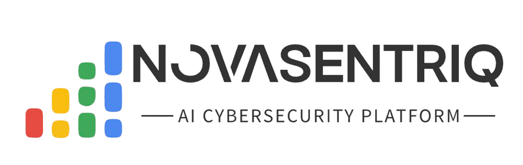
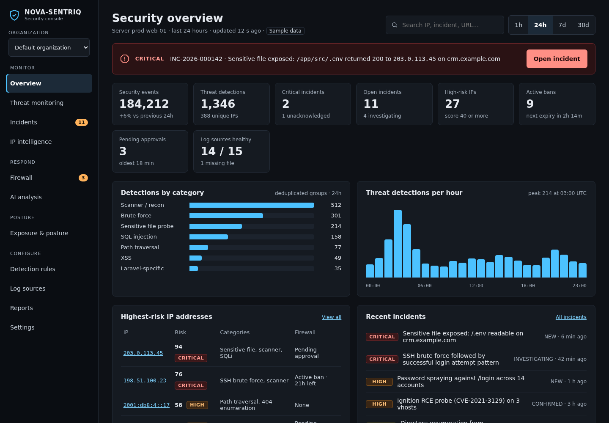
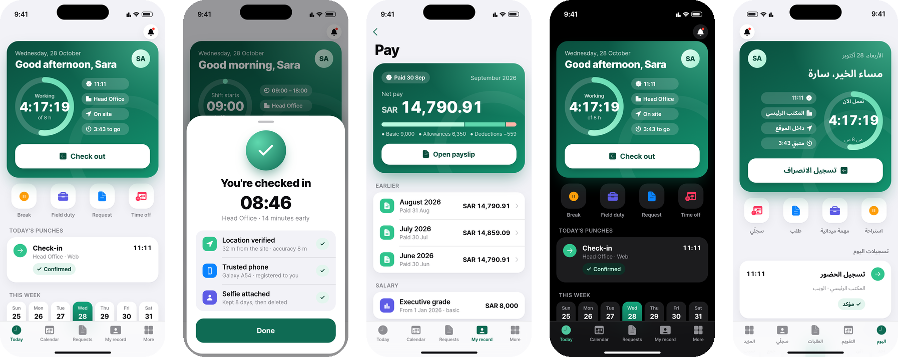

<p align="center">
  
</p>

<p align="center">
  
</p>

<p align="center">
  <a href="https://novatecsolution.com"></a>
  <a href="#lets-work-together"></a>
  
</p>

---

I design and build the software that businesses trust with **their money, their patients and their children's safety**.
For 12+ years I've taken products from a blank page to production: architecture, backend, mobile, security, and the infrastructure that keeps it all running.

Right now I'm building **five commercial platforms** for the GCC and Pakistan, covering cybersecurity, HR & payroll, healthcare, family safety and on-demand services.

```php
final class RayJohnson extends SoftwareArchitect
{
    public int    $yearsShipping = 12;
    public string $basedIn       = 'Pakistan, working across the GCC';
    public array  $building      = ['NOVA-SENTRIQ', 'HRNova', 'NovaMedical', 'NovaNestora', 'iConnect'];
    public array  $strengths     = ['multi-tenant SaaS', 'security engineering', 'private AI', 'mobile'];
    public array  $speaks        = ['PHP', 'Python', 'TypeScript', 'Dart', 'Kotlin'];
    public string $openTo        = 'architecture consulting, contract builds, technical partnerships';
}
```

## What I'm building

<sub>These are commercial products, so their source is private. Live demos and architecture walkthroughs are available on request.</sub>

<br>

<p align="center">
  <picture>
    <source media="(prefers-color-scheme: dark)" srcset="assets/nova-sentriq-logo-on-dark.png">
    
  </picture>
</p>

<p align="center"><b>A private AI security analyst for every web server.</b></p>

NOVA-SENTRIQ watches server and application logs around the clock, detects attacks, explains incidents in plain language and recommends firewall blocks that a person approves. **No external AI APIs are used, and logs never leave the server.**

<p align="center">
  
  <br><sub>Security console (sample data)</sub>
</p>

- **Detect:** signature rules for SQLi, XSS, path traversal and scanners; behaviour scenarios for brute force and credential spraying; Isolation Forest anomaly scoring.
- **Score:** a 0–100 risk score per IP with decay and deduplication, enriched with offline threat intelligence.
- **Explain:** a local LLM (Ollama) whose output is schema-validated and must cite its evidence.
- **Protect:** blocks need a person's approval (password + 2FA). A sandboxed helper applies them, and every action goes on a hash-chained audit trail.

`Python 3.12` `FastAPI` `Pydantic v2` `scikit-learn` `Redis Streams` `Fluent Bit` `Laravel 13` `React + TypeScript` `shadcn/ui` `MySQL 8` `Ollama`

<br>

### 🏢 HRNova
**Enterprise HRM, payroll and accounts for the GCC (UAE, KSA, Qatar) and Pakistan**

<p align="center">
  
  <br><sub>Employee app: live shift, verified check-in, payslips, dark mode and Arabic (RTL)</sub>
</p>

- **Hire to retire on one platform:** recruitment, attendance, leave, workflows, training, performance, expenses, travel and asset custody.
- **Payroll per country:** each jurisdiction's statutory tax and contributions, plus quotations, purchase orders and VAT-aware billing.
- **Attendance:** location-verified, trusted-device check-in from a Flutter app, with a React SPA and a Livewire admin panel.
- **Documented decisions:** 58 architecture decision records explain every non-obvious choice in the codebase.

`Laravel 13` `PHP 8.5` `Livewire 4` `React` `TanStack Query` `Flutter` `MySQL 8.4` `Docker`

<br>

<table>
<tr>
<td width="50%" valign="top">

### 💊 NovaMedical
**Pharmacy POS and medical inventory SaaS**

- One database per pharmacy, isolated by connection rather than by a `WHERE` clause
- Batch tracking with FEFO allocation, prescriptions, credit, returns and thermal receipts
- TOTP 2FA, audited disclosures and an Arabic (RTL) interface

`Laravel 13` `Livewire 4` `Alpine.js` `MySQL 8.4` `Redis`

</td>
<td width="50%" valign="top">

### 👨‍👩‍👧 NovaNestora
**Parental protection and smart screen time, end-to-end encrypted**

- The server is a zero-knowledge relay: it can't read a child's name, usage, rules or face
- libsodium throughout: X25519 sealed boxes and Ed25519 signatures over Protocol Buffers
- Native Kotlin child app (Android Device Owner) and a Flutter parent app for Android and iOS

`Kotlin` `Flutter` `Laravel` `libsodium` `Protobuf`

</td>
</tr>
<tr>
<td width="50%" valign="top">

### 🔧 iConnect
**On-demand marketplace for skilled trades**

- Customers post a job, and geospatial matching dispatches it to nearby verified workers
- A wallet that holds payment for 72 hours, so customers can raise problems, with ratings and disputes
- One Flutter app for customers and workers, a JSON API, real-time WebSockets and an operations panel with a live map

`Flutter` `Laravel 12` `MySQL spatial` `Redis` `WebSockets`

</td>
<td width="50%" valign="top">

### 🤝 Your product here
**Open to consulting, contract builds and technical partnerships**

- A new SaaS, from zero to production
- Moving a single-tenant app to multi-tenant
- Security reviews and hardening for Laravel/PHP
- Private, on-premise AI for an existing product
- Modernising legacy PHP to PHP 8.4+ and Laravel 13

**[Let's talk →](#lets-work-together)**

</td>
</tr>
</table>

## How I build

<table>
<tr>
<td width="50%" valign="top">🔐 <b>Security by design</b><br>End-to-end encryption, 2FA, least-privilege helpers and tamper-evident audit trails from day one.</td>
<td width="50%" valign="top">🏢 <b>Real multi-tenancy</b><br>Database-per-tenant isolation, automated provisioning and per-tenant hostnames.</td>
</tr>
<tr>
<td valign="top">🤖 <b>Private AI</b><br>Local LLMs and classic machine learning, so customer data never leaves the customer's server.</td>
<td valign="top">📐 <b>Decisions on paper</b><br>Architecture decision records, threat models, ERDs and API contracts are written before the code.</td>
</tr>
<tr>
<td valign="top">🧪 <b>Tested against reality</b><br>Test suites run on real MySQL, spatial queries included, with one-command Docker environments.</td>
<td valign="top">🌍 <b>Built for the region</b><br>Arabic (RTL) interfaces, plus GCC and Pakistan tax, payroll and compliance rules.</td>
</tr>
</table>

## Tech stack

<table>
<tr><td><b>Backend</b></td><td></td></tr>
<tr><td><b>Frontend</b></td><td></td></tr>
<tr><td><b>Mobile</b></td><td></td></tr>
<tr><td><b>Data and AI</b></td><td></td></tr>
<tr><td><b>DevOps</b></td><td></td></tr>
</table>

Also: `Livewire` `Alpine.js` `Inertia` `shadcn/ui` `Pydantic` `Ollama` `Fluent Bit` `libsodium` `Protocol Buffers` `WebSockets`

## Activity

<picture>
  <source media="(prefers-color-scheme: dark)" srcset="https://raw.githubusercontent.com/RMPJohnson/RMPJohnson/output/github-snake-dark.svg">
  <source media="(prefers-color-scheme: light)" srcset="https://raw.githubusercontent.com/RMPJohnson/RMPJohnson/output/github-snake.svg">
  
</picture>

## Let's work together

Have a product to build, a platform to secure or a legacy system to modernise? I'd like to hear about it.

<p>
  <a href="https://novatecsolution.com"></a>
</p>


